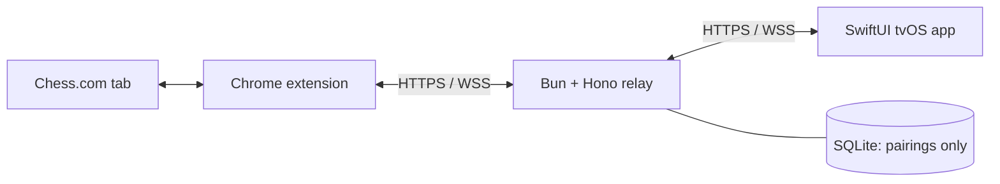

# Chess TV MVP architecture

Status: Standard Chess.com bot games are connected to the native Apple TV app. Pairing, remote-selected moves, bot replies, recovery, special moves, player names, clocks, and results are implemented. Live browser and tvOS simulator verification is recorded in extension/README.md; physical Apple TV hardware validation remains separate.

## 1. Goal and scope

Play a standard Chess.com bot game on Apple TV with the Siri Remote while an awake Mac keeps the connected Chrome tab selected and visible. Sign in and start the game in Chrome, then explicitly attach it through the extension. Installation is manual; one extension pairs with one TV, with one attached game at a time.

The MVP includes remembered pairing, piece moves, all promotion choices, players, turn, clocks, results, and safe reconnection. Move-history UI, resignation, and draw responses stay in Chrome. TV matchmaking, account navigation, premoves, bullet/blitz, Daily chess, variants, analysis, recommendations, gamepad-specific support, public distribution, and horizontal scaling are outside the MVP.

## 2. Stack and structure

Chess.com's observed state is authoritative. The extension observes the page and performs human-selected moves. The relay authenticates and routes messages. The TV renders snapshots and requests moves.

Use a small Bun workspace containing `extension`, `relay`, and `protocol` packages, alongside a native Xcode project. Share TypeScript protocol definitions directly; align Swift `Codable` types through JSON fixtures. No generated clients or library publishing pipeline is needed.

| Area                                 | Choice                                                                             |
| ------------------------------------ | ---------------------------------------------------------------------------------- |
| Package management and relay runtime | Bun; commit the lockfile and pin tool versions                                     |
| Extension                            | Manifest V3, TypeScript, React popup, Tailwind, selected shadcn/ui components      |
| Web tooling                          | Vite+ for extension builds, Oxlint, Oxfmt, TypeScript checks, and Vitest           |
| Relay                                | Hono with `upgradeWebSocket` and `websocket` from `hono/bun`                       |
| Database                             | SQLite through `SQL` imported from `bun`, with parameterized queries               |
| TV                                   | SwiftUI, tvOS 27.0 minimum, Xcode 27 or newer, `URLSessionWebSocketTask`, Keychain |

Vite+ tooling uses a supported Node runtime; Bun remains the package manager and application runtime. Its bundled Vitest requires Node `^22.18.0 || ^24.11.0 || >=26.0.0` in the documentation reviewed. Pin a compatible version when scaffolding. Keep shared `lint`, `fmt`, and `test` configuration in the root `vite.config.ts`, with `typeAware` and `typeCheck` enabled. Add only extension-specific build configuration in its package. Avoid separate ESLint, Prettier, and Vitest installations.

| Command                             | Purpose                                               |
| ----------------------------------- | ----------------------------------------------------- |
| `vp check`                          | Non-mutating formatting, lint, and type checks        |
| `vp check --fix`                    | Formatting and automatic fixes                        |
| `vp test`                           | Protocol, adapter, popup, and relay integration tests |
| `vp build` in the extension package | Bundle the extension for manual installation          |

Swift builds and tests remain in Xcode. Sources: [Vite+ checks](https://viteplus.dev/guide/check), [Vite+ tests](https://viteplus.dev/guide/test), [Hono WebSockets](https://hono.dev/docs/helpers/websocket), [Bun SQL](https://bun.sh/docs/runtime/sql), and [shadcn/ui with Vite](https://ui.shadcn.com/docs/installation/vite).

## 3. Component responsibilities

### Chrome extension

Keep three platform-required parts:

- **Popup:** pairing, status, “Connect this game,” disconnect, and unpair. Use locally bundled React, Tailwind, and only the shadcn/ui controls needed. Do not inject popup styles into Chess.com. Closing the popup does not stop the connection.
- **Service worker:** credentials, relay connection, explicit tab binding, protocol validation, and reconnect coordination.
- **Content script:** one concrete Chess.com adapter for observation and page interaction. It owns verified game revisions and move deduplication before interacting with the page. Keep selectors here; do not introduce a generic adapter framework.

Use Chrome 116+ and exchange application heartbeats every 20 seconds. WebSocket activity can keep the worker alive within Chrome's activity window, but browser exit, sleep, and network loss still require recovery. See [Chrome WebSocket guidance](https://developer.chrome.com/docs/extensions/how-to/web-platform/websockets).

Request storage and scripting permissions with narrowly scoped host access. Store credentials in extension-local storage restricted to trusted extension contexts; do not send them to content scripts. No cookie or general browsing access is needed.

Attach only the user-selected game. Tab hiding, navigation, closure, or unreliable extraction disables TV input. A reload may resume only after verifying the same game; a new game always requires explicit attachment.

### Hosted relay

Run one Bun/Hono process behind a TLS reverse proxy with a persistent SQLite volume. Both clients connect outbound. Use direct parameterized SQL and a small schema initialization script. No ORM, repository layer, broker, or separate WebSocket server.

The relay authenticates devices, enforces endpoint roles and pairing isolation, validates protocol versions, message shapes, sizes, and rates, and forwards messages. Keep live connections, session generations, and expiring pairing challenges in memory. Persist only pairings and hashed, revocable device credentials.

Do not cache snapshots, persist games, interpret chess positions, duplicate extension game-state checks, or confirm moves. After reconnecting, request a fresh snapshot from the extension. Provide a health endpoint and concise operational logs without credentials, pairing codes, snapshots, or move payloads. Keep authentication material out of URLs and proxy logs.

TLS termination and the host are trusted; end-to-end encryption is outside the MVP. Chess.com credentials and cookies remain in Chrome. Relay restart preserves pairings but invalidates live sessions; database loss requires pairing again.

### Native TV app

Use SwiftUI's `App` and scene lifecycle, one root-owned `@MainActor @Observable` session model, small views with explicit inputs, and a concrete WebSocket client. Keep local selection in view state and credentials in Keychain. No per-screen view models, coordinator, dependency-injection framework, or local game database.

Render pairing, waiting, board, and result states. Show interruptions inline over the last known board. Orient the board to the player's color while keeping protocol coordinates independent of orientation. Select a source and destination; offer queen, rook, bishop, or knight for promotion. Selection and pending highlights can update immediately; pieces change only after a verified snapshot.

## 4. Pairing, protocol, and recovery

### Remembered pairing

1. The TV requests a five-minute display code and a separate private challenge credential over TLS.
2. The user enters the code in the extension; the TV displays a confirmation request.
3. TV confirmation with the private credential creates the pairing and delivers separate high-entropy credentials to both devices. Store only hashes on the relay and consume the code.

Limit code creation and attempts. Expired, consumed, or locked challenges require a new code. Authenticate before routing and allow one active connection per role; a replacement closes the old connection. Disconnect ends attachment while preserving pairing. Unpair revokes both credentials and closes connections. Offline local removal must clearly report that remote revocation remains incomplete; it must not claim success.

### Minimal JSON contract

Use a versioned envelope and reject incompatible versions with an actionable error. Pairing, authentication, revocation, and heartbeats accompany these gameplay messages:

| Message           | Contents and responsibility                                                                                                                 |
| ----------------- | ------------------------------------------------------------------------------------------------------------------------------------------- |
| Attachment/status | Game identity, session generation, availability, and reason when input is blocked                                                           |
| Full snapshot     | Game identity, generation, position revision, board placement, player/color, side to move, observed clocks with timing metadata, and result |
| Move request      | Unique command ID, expected game/generation/revision, source, destination, and promotion choice when needed                                 |
| Move outcome      | Command ID and rejected, pending/uncertain, or observed-complete outcome                                                                    |
| Snapshot request  | Ask the extension to observe and publish fresh state                                                                                        |

Represent unknown values explicitly, including clocks; unknown is not zero. No history payload, general capability framework, resignation command, or draw-response command is needed.

The relay issues a new opaque session generation whenever either connection is replaced or attachment changes, and shares it with both endpoints. The extension must adopt it before publishing fresh state. Both clients reject older generations. The extension advances position revision for board or move-relevant status changes, but not clock-only updates.

The adapter requires reliable game identity, board, player, and turn observation, plus reliable move acceptance detection. Chess.com remains authoritative for acceptance. The extension replays the complete recorded history with chess.js to reject illegal user-selected moves and checks the resulting placement against every rendered square. It never chooses a move, infers castling/en-passant rights from placement alone, or updates the TV speculatively.

### Move and recovery rules

- Permit one pending move. Immediately before page interaction, the adapter rechecks game, generation, revision, turn, and availability, and deduplicates the command ID. Return the known outcome for a repeated ID.
- A delivery acknowledgment is not completion. Completion requires observing the corresponding website change. Ingest direct Chrome input first and reject stale TV requests.
- After five seconds without completion, show “Checking move” and request a snapshot. Do not infer rejection or resend.
- On transport loss, stale observation, hidden tab, Mac sleep, or TV suspension, disable input. Reconnect with bounded exponential backoff and jitter, authenticate, and obtain a new-generation snapshot before enabling moves.
- Never replay uncertain moves. Reconcile against fresh state; if ambiguous, keep input disabled and ask the user to inspect Chrome and reconnect the game. Lost adapter deduplication state requires a new session generation.
- A changed game ends attachment. Unsupported page structure produces a visible error, not blind retries.
- Estimate running clocks using monotonic elapsed time between observations; correct on new snapshots and freeze or mark stale when disconnected. Only the website establishes results, including timeout.

Full snapshots are the only recovery mechanism; incremental patches and durable command queues are unnecessary.

## 5. tvOS 27+ implementation and Human Interface Guidelines

Use the Build macOS Apps skill's transferable principles: narrow state ownership, small focused views, and native controls. Its AppKit, desktop windowing, and keyboard/menu navigation patterns do not apply to this app.

### Version-specific implementation notes

Apple's [tvOS 27 release notes](https://developer.apple.com/documentation/tvos-release-notes/tvos-27-release-notes) establish these relevant changes:

- Apps built with the latest SDK must use the scene-based lifecycle. Use SwiftUI's `App` lifecycle.
- Xcode 27's `@State` macro avoids repeatedly evaluating initial values. If initializing state in a view initializer, omit a competing declaration-site initial value.
- tvOS buttons no longer automatically use the asset-catalog accent color as their label tint. Use semantic defaults and apply intentional tint only where needed.

Use `scenePhase` to stop accepting input while inactive and resynchronize on return. No older-tvOS compatibility layer is needed. The following design guidance applies to tvOS generally, including 27; it is not a claim that every behavior was introduced in 27.

### Minimal TV interface

- **Content first:** make the board dominant, with a compact group for players, clocks, turn, and status. Avoid a dashboard, permanent sidebar, decorative cards, or move-history panel.
- **Across-room readability:** respect safe areas, use readable system typography and generous spacing, and support text-size changes without clipping the board or controls. Keep the board square and coordinates legible in either orientation.
- **Predictable focus:** use native directional focus and stable square identities. Distinguish focused square, selected piece, and pending destination. Incoming snapshots must not steal focus. All interactive controls must be reachable with the remote.
- **Simple input:** Select chooses source/destination. Back cancels selection or dismisses promotion, then follows normal navigation. Use native controls for pairing and promotion; restore board focus after dismissal. Pairing code entry occurs in Chrome to minimize TV typing.
- **Restrained materials:** keep board squares opaque and high contrast. Let system controls receive native focus and Liquid Glass effects; do not cover the board in glass or add competing focus animations.
- **Accessible feedback:** label each square with coordinate and piece for VoiceOver, expose selection/pending state, and never rely only on color. Respect reduced motion, reduced transparency, and increased contrast. Avoid announcing every clock tick.
- **Quiet recovery:** retain the last board with a clear stale/connection status and disabled move submission. Reserve modal UI for decisions requiring attention. Keep transitions subtle and avoid shifting layout when clocks update.

Sources: [Designing for tvOS](https://developer.apple.com/design/human-interface-guidelines/designing-for-tvos), [Focus and selection](https://developer.apple.com/design/human-interface-guidelines/focus-and-selection/), [Layout](https://developer.apple.com/design/human-interface-guidelines/layout), and [Adopting Liquid Glass](https://developer.apple.com/documentation/TechnologyOverviews/adopting-liquid-glass).

## 6. Integration feasibility and authorization

Observation and page interaction have been verified on standard bot games in the live browser. Chrome's [content-script model](https://developer.chrome.com/docs/extensions/develop/concepts/content-scripts) permits DOM access, but does not establish that Chess.com exposes stable game identity, board, turn, clocks, result, or reliable move acceptance. Keep compatibility checks focused on bot pages, including all promotion choices.

Use captured Chess.com DOM fixtures and user-selected moves in real bot games. Preserve the requirement to obtain appropriate authorization before real Chess.com integration testing under its [User Agreement](https://www.chess.com/legal/user-agreement); none is assumed granted. Its [public API guidance](https://support.chess.com/en/articles/9650547-what-is-the-pubapi-and-how-do-i-use-it) describes a read-only API and developer application route. Confirm that the proposed interaction can be supported through that route.

Do not use private endpoints, export login data, bypass safeguards, or silently expand permissions. If reliable observation and human-selected move execution cannot be demonstrated, stop the integration and document the failed assumption.

## 7. Validation and delivery

Implement in this order: real Chess.com move verification, one complete vertical slice from pairing to a confirmed move, recovery, then visual polish. Authorized real-site checks follow the feasibility and authorization requirements above.

Run TypeScript suites with `vp test`. Relay integration tests launch the actual Bun process with a temporary SQLite database and simulated WebSocket clients; do not mock Bun SQL or import Bun-only modules into Node-based Vitest. Clean up processes and databases after each run. Share protocol fixtures with Swift tests and verify the complete extension-to-TV flow against a real Chess.com bot game.

| Area                  | Acceptance scenarios                                                                                                                                                                                                 |
| --------------------- | -------------------------------------------------------------------------------------------------------------------------------------------------------------------------------------------------------------------- |
| Pairing and isolation | TV confirmation, expiry/attempt limits, restart persistence, revocation, replacement connections, wrong-role/pairing rejection, malformed/oversized/version-incompatible messages                                    |
| Moves                 | Both orientations, coordinate mapping, castling, en passant, all promotions, illegal move rejection, stale/duplicate commands, one pending move, simultaneous Chrome input                                           |
| Recovery              | Disconnect before submission, after page interaction, and before outcome delivery; no replay; hidden/reloaded tab, Mac sleep, TV suspension, relay restart, lost adapter state, fresh snapshot before input          |
| Game state            | New game requires attachment, broken layout disables input, observed results include games ended in Chrome, clocks correct and become stale appropriately                                                            |
| Extension             | Production Manifest V3 package loads with local assets, narrow permissions, isolated popup styling, and a connection that survives popup closure                                                                     |
| tvOS                  | Xcode build/tests, Siri Remote hardware testing, stable focus during updates, Back behavior, promotion focus restoration, viewing-distance legibility, text sizing, VoiceOver, contrast/motion/transparency settings |
| Operations            | Health endpoint, SQLite persistence, clean test-process shutdown, and no credentials or game payloads in application/proxy logs                                                                                      |

Run `vp check`, `vp test`, and the extension's `vp build` once implementation exists. For this documentation change, verify scope and terminology consistency, source references, and that deferred features do not remain in MVP interfaces or acceptance criteria.
