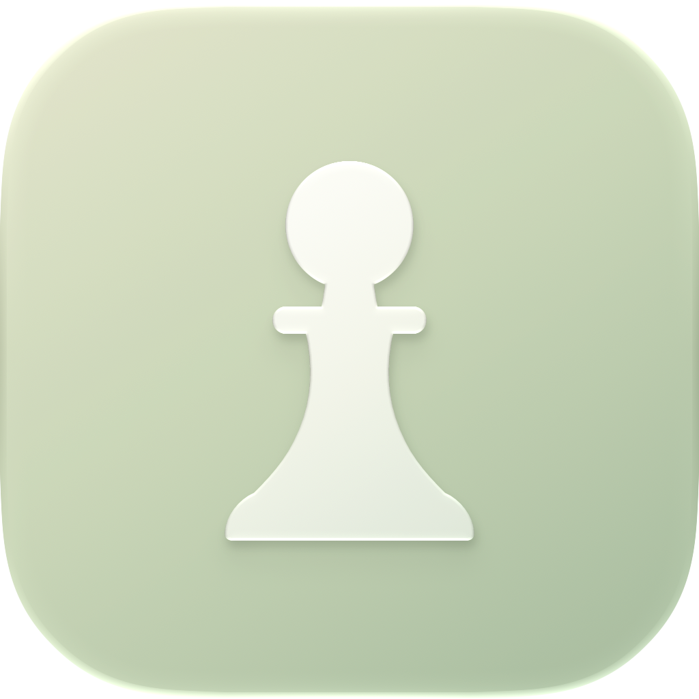
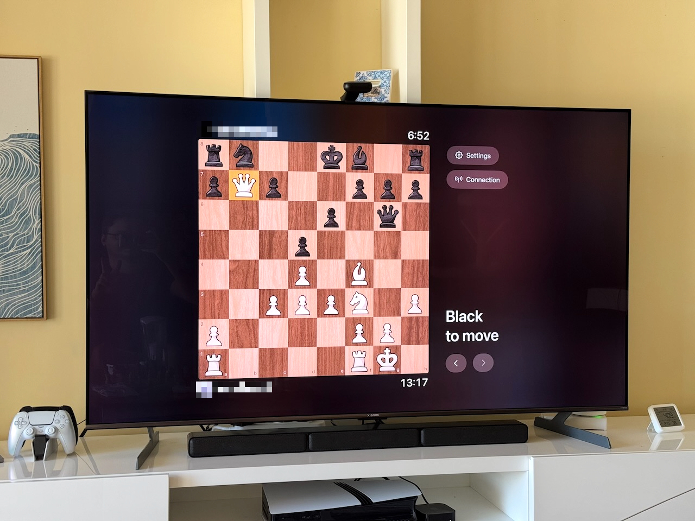

<p align="center"></p>

# Chess TV

Play standard Chess.com or Lichess games on Apple TV, or watch Chess.com games. Use the TV remote to choose
pieces and moves while your game runs in either the native Mac app or a Chrome
extension. The Mac app also supports spoken moves, with or without a TV.



Chess TV is a prototype built from source. It supports standard bot and online
games, plus read-only spectating. Custom starting positions and chess variants
are unsupported. It validates your chosen moves; it does not choose moves for you.

## How it works

```text
Chess.com / Lichess ↔ Mac app or Chrome extension ↔ relay ↔ Apple TV app
```

Choose one browser client for each TV pairing. The browser observes the actual
Chess.com board or streams Lichess state through its Board API, then submits your chosen moves; the TV displays that state. A Bun relay routes
messages and stores pairing IDs and credential hashes in SQLite.

| Component    | Purpose                                               | Details                                             |
| ------------ | ----------------------------------------------------- | --------------------------------------------------- |
| `tv/`        | Native SwiftUI Apple TV app                           | [TV setup and controls](tv/README.md)               |
| `mac/`       | Native Mac browser and voice control                  | [Mac setup and voice commands](mac/README.md)       |
| `extension/` | Chrome browser client                                 | [Extension setup and recovery](extension/README.md) |
| `relay/`     | Pairing API and WebSocket relay                       | [Hosting and protocol](relay/README.md)             |
| `protocol/`  | Shared TypeScript schemas and cross-platform fixtures | [Schemas](protocol/src/index.ts)                    |

Lichess requires a separate **Connect Lichess** authorization in each client. Its Board API supports standard rapid, classical, correspondence, and blitz direct challenges or AI games. See the [extension](extension/README.md#lichess) or [Mac](mac/README.md#lichess) instructions for setup and limits.

## Requirements

- A Mac with Xcode 27+ and the tvOS 27 SDK/simulator for the TV app; a compatible
  Apple TV running tvOS 27+ for physical-device play.
- Bun **1.4.2** and Node **24.21.0**, as pinned in `package.json` and `.node-version`.
  Vite+ is installed with the workspace dependencies.
- For the Mac client: macOS 14+, Python 3, and an Apple Development signing
  identity. Initial speech-runtime setup needs internet access; missing
  CMake/Ninja tools are installed locally by the setup script.
- For the extension client: Chrome 116+.
- A Chess.com or Lichess account to play signed-in games, and a relay reachable by both clients.

Run the following commands from the repository root unless stated otherwise:

```sh
bun install --frozen-lockfile
```

## Start playing

### 1. Choose a relay

Both clients default to `https://chess-tv-relay.kodkod.me`. This is the project's
configured hosted relay; availability is not guaranteed. You can use your own
relay instead. Both ends of a pairing must use the **same origin**.

For a physical Apple TV, use a reachable HTTPS relay with a trusted certificate.
For development entirely on one Mac, follow [Local development](#local-development).

### 2. Run the Apple TV app

```sh
cp -n tv/Config/Local.xcconfig.example tv/Config/Local.xcconfig
```

Edit this ignored local file to select your relay and, for a device build, set
`DEVELOPMENT_TEAM` to your own Apple team ID. Then start the simulator:

```sh
./tv/script/build_and_run.sh
```

The script selects an installed tvOS 27 simulator. Set `TV_SIMULATOR_ID` to use a
specific one. For a physical device, open `tv/ChessTV.xcodeproj`, select the
**ChessTV** scheme and your Apple TV destination, and run. Keep simulator code
signing enabled so Keychain works.

### 3. Run a browser client

**Option A: native Mac app**

```sh
cp -n mac/Config/Local.xcconfig.example mac/Config/Local.xcconfig
```

Replace `YOUR_TEAM_ID` in the ignored local file with the team for your installed
Apple Development identity, then build and launch:

```sh
./mac/script/build_and_run.sh
```

The first build prepares the speech runtime. Sign in to Chess.com inside the app;
its browser profile is separate from Chrome. Use Chess.com's username/password
login, since external-provider popup sign-in is not implemented.

**Option B: Chrome extension**

```sh
bun run --bun vp build --config extension/vite.config.ts
```

Open `chrome://extensions`, enable **Developer mode**, choose **Load unpacked**,
and select `extension/dist`. Sign in to Chess.com in Chrome. After rebuilding,
reload the extension and the Chess.com page.

### 4. Pair and play

1. Request a six-digit pairing code in the TV app.
2. Enter it in **… → Pair TV** on the Mac, or in the Chrome extension popup.
   The current TV app automatically confirms a claimed code. Codes expire after
   five minutes; request another if needed.
3. Open a standard bot game at `https://www.chess.com/play/computer`, or an online
   game. The client attaches automatically when it recognizes the game.
4. On the TV, select a piece and then a highlighted destination. Back cancels
   selection; promotions offer Queen, Rook, Bishop, and Knight.

Choose opponents, time controls, new games, and resignation on Chess.com. Keep
the Mac awake and the browser client running. Chrome needs the game tab selected
and visible; the native Mac app can continue while hidden or minimized.

Watching another player's online game is read-only. TV **Settings** controls
square labels, highlights, sounds, and connection recovery. The back/forward
buttons review moves observed since the latest synchronization.

## Voice commands on Mac

Click the microphone in the Mac toolbar and grant microphone permission. In
**… → Voice Settings…**, select Apple recognition (macOS 26+) or download Parakeet
Unified English (Apple Silicon, macOS 14+, about 733 MB including its detector).
Recognition runs locally. Listening starts off each time the app launches.

Say a piece and destination, such as “Knight F3”, “Pawn D4”, or “Rook from B1 to
B4”. Castling and promotion are supported. A uniquely identified legal move plays
immediately; ambiguous commands ask you to repeat. Voice also works without a TV.

Optional Jev interpretation requires a key saved through Voice Settings into
Keychain. When enabled, unrecognized commands can send transcript text and legal
move descriptions to Jev. Audio is not uploaded. See the [voice guide](mac/README.md#voice-control)
for commands, settings, and debugging.

## Local development

Start a relay on the Mac:

```sh
bun run dev
# In another terminal:
curl --fail http://127.0.0.1:3000/health
```

The relay creates `data/relay.db` automatically. `bun run start` runs without
watching. Configure `HOST`, `PORT`, and `DATABASE_PATH` if needed.

Point each client at the local relay:

- **TV simulator:** set these lines in `tv/Config/Local.xcconfig`, then rebuild:

  ```text
  SLASH = /
  RELAY_ORIGIN = http:$(SLASH)$(SLASH)127.0.0.1:3000
  ```

- **Chrome:** rebuild with the origin embedded in the extension, then reload it:

  ```sh
  RELAY_URL=http://127.0.0.1:3000 bun run --bun vp build --config extension/vite.config.ts
  ```

- **Mac app:** after running `./mac/script/prepare_speech_runtime.sh`, open
  `mac/ChessTVMac.xcodeproj`. Set `RELAY_URL` to `http://127.0.0.1:3000` in the
  **ChessTVMac** scheme's Run environment and run the Debug build from Xcode.

HTTP is supported only on loopback for development. A physical Apple TV cannot
reach your Mac through `127.0.0.1`; use HTTPS hosting instead. See the
[relay deployment guide](relay/README.md#railway-deployment) for a hosting example.

## Troubleshooting

- **Pairing fails:** check that both clients use the same relay, verify its
  `/health` endpoint, and request a fresh code. Pair again after changing origins.
- **The board is unavailable:** open a supported standard game. In Chrome, keep
  the tab visible. Use the client's Connect/Reconnect Game action if needed.
- **A move was interrupted:** inspect the actual Chess.com board, then explicitly
  reconnect the game in the browser client. Uncertain moves are never replayed
  automatically; reconnecting only the TV transport does not clear uncertainty.
- **Signing fails:** configure your own team in the ignored local xcconfig and
  install its development identity through Xcode.
- **After updates:** update relay, browser client, and TV together. They use
  protocol v3 and reject incompatible versions.

## Development checks

```sh
bun run check
bun run test
bun run --bun vp build --config extension/vite.config.ts
```

Native test and integration commands are in the [TV](tv/README.md#verification)
and [Mac](mac/README.md#verification) guides. Device focus, permissions, and live
Chess.com behavior also need manual verification.

## Private configuration and data

Keep credentials out of source files. Local environment files, signing overrides,
private keys/certificates, databases, logs, Xcode user state, and build output are
ignored by Git. Commit only placeholder example configuration. Ignore rules do
not remove files already committed or erase Git history.

Native pairing credentials and the optional Jev API key live in Keychain. The
Chrome client stores its pairing credential in browser-local extension storage.
The relay database contains pairing records and credential hashes; keep its
database, backups, and volume private. Relay traffic includes game state and
player information, so use a relay you trust.

Voice debug exports contain transcripts and board positions. Review them before
sharing, and never commit browser profiles, pairing credentials, API keys, or
copied private diagnostics. Public relay origins are configuration, not secrets.

Bundled artwork and sounds have source information in
[theme-sources.json](tv/ChessTV/theme-sources.json) and
[capture-sources.json](tv/ChessTV/Sounds/capture-sources.json). Consult those records
and the speech-runtime/model notices before redistributing assets.
